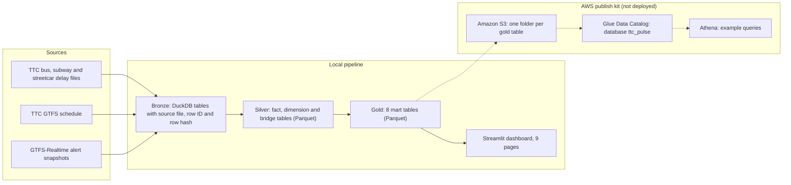

# TTC Pulse

TTC Pulse scores how reliable TTC bus, subway and streetcar service has been, by route, station, hour and cause. It is a team project from a Data Analytics and Visualization course at York University (Winter 2026). It joins 1,111,831 delay events from 1 January 2014 to 31 January 2026 with the TTC schedule (GTFS) and live service alerts. The pipeline uses DuckDB and Parquet, and a Streamlit dashboard shows the results. 97.7% of bus delay events match a GTFS route.

## Architecture



## Results

Every figure comes from the committed files. Run `python3 scripts/check_readme_numbers.py` to print each one.

- **Delay events:** 1,111,831 (bus 723,518, subway 235,397, streetcar 152,916). Source: `silver/fact_delay_events_norm.parquet`.
- **Bus route match:** 97.7% of bus events (706,725 of 723,518) match a GTFS route. Source: `link_status` in the fact table, and `gold/gold_linkage_quality.parquet`.
- **Match method:** 95.8% of events match on the exact name. 4.2% match on tokens. Source: `match_method` in the fact table.
- **Coverage:** 71 subway stations, 4 subway lines, 10 streetcar routes and 284 bus route keys. 204 of the bus route keys match a GTFS route.
- **Route scores:** 893,537 rows of route, date and hour. The stored composite score matches a recalculation from its four inputs. The largest difference is 2.2e-16. Source: `gold/gold_route_time_metrics.parquet` and `src/ttc_pulse/marts/scoring.py`.
- **Alert validation:** 37 alerts and 5,984 entity rows. 5,957 rows (99.5%) match a GTFS route. The table comes from one build on 16 April 2026, so it does not show when each alert started. Source: `gold/gold_alert_validation.parquet`.
- **Known gap:** 16,793 bus events (2.3%) do not match a route. They keep their original route key and have `link_status = unmatched_review`.

## Data model

Silver tables (Parquet):

- `fact_delay_events_norm`: fact, one row per delay event (1,111,831 rows).
- `fact_gtfsrt_alerts_norm`: fact, one row per alert entity (5,984 rows).
- `dim_route_gtfs`: dimension, GTFS routes (229).
- `dim_stop_gtfs`: dimension, GTFS stops (9,417).
- `dim_service_gtfs`: dimension, GTFS service calendars (8).
- `dim_route_alias`: dimension, route name variants (865).
- `dim_station_alias`: dimension, station name variants (13,860).
- `dim_incident_code`: dimension, incident codes (267).
- `bridge_route_direction_stop`: bridge, links between route, direction and stop (17,824).

Gold marts (Parquet, 8 tables, 22.0 MB in total):

- `gold_delay_events_core`: event counts by mode, date, hour, route or station, and incident category (1,086,378 rows).
- `gold_route_time_metrics`: route scores by mode, date and hour (893,537).
- `gold_station_time_metrics`: subway station scores by date and hour (223,480).
- `gold_time_reliability`: scores by mode, weekday and hour (504).
- `gold_top_offender_ranking`: ranked routes and stations for 31 January 2026 (283).
- `gold_alert_validation`: alert entity rows checked against GTFS (5,984).
- `gold_spatial_hotspot`: subway station points with scores (71).
- `gold_linkage_quality`: match counts by mode, period, method and status (752).

## Lineage and data quality

- **Source registry.** Four CSV registries list each source file with its size, modified time and SHA-256 checksum: `raw/bus/`, `raw/subway/`, `raw/gtfs/` and `raw/gtfsrt/`. The checksum comes from `file_checksum` in `src/ttc_pulse/utils/project_setup.py`. In every registry row, the last field is a SHA-256 value. The registries mix two row layouts under one header, so most rows have more fields than the header lists. Read the checksum from the last field.
- **Snapshot check.** All 234 committed GTFS-Realtime snapshot files are listed in the registry. 174 match the recorded SHA-256. 60 do not. Those 60 files are smaller than the size recorded in the registry.
- **Row-level source IDs.** Each delay event carries `source_file`, `source_row_id` and `row_hash` from bronze into the fact table. The pair (`source_file`, `source_row_id`) is unique within each mode. The gold marts aggregate these rows, so they do not keep the IDs. Code: `src/ttc_pulse/bronze/build_bronze_tables.py` and `src/ttc_pulse/normalization/normalize_bus.py`.
- **Match tiers.** Normalization labels each event `exact`, `token` or `fallback`, and sets `match_confidence`. The committed fact table has only `exact` and `token` rows. Code: `src/ttc_pulse/normalization/`.
- **QA checks.** These checks write their results. They do not stop a build.
  - The bus gate summary, `src/ttc_pulse/qa/build_bus_quality_gate_summary.py`, writes 10 rows to `outputs/qa/`: 9 metrics and a timestamp. That folder is not committed.
  - The subway station gate, in `src/ttc_pulse/marts/build_gold_station_metrics.py`, sets the thresholds at lines 25 to 27. It checks the thresholds at lines 392 to 410: station linkage of at least 0.80, ambiguous share below 0.15, and at least 1,000 high-confidence rows. If a check fails, the mart status is `built_with_caveats`.
- **Checks you can run.** Summing the committed gold table by mode gives the event totals above:

```sql
SELECT mode, sum(event_count) AS events
FROM read_parquet('gold/gold_delay_events_core.parquet')
GROUP BY mode;
```

## Tech stack

- Python, DuckDB, pandas and PyArrow.
- Parquet with ZSTD compression for silver and gold tables.
- Streamlit for the dashboard, with Altair charts.
- GTFS-Realtime decoding with `gtfs-realtime-bindings` and `protobuf`.
- APScheduler polls the alert feeds every 30 seconds inside the Live Alert page. launchd on macOS and Task Scheduler on Windows run a poll every 30 minutes.
- The OpenAI Python SDK, with the Responses API, for the AI chat page and the AI explain buttons.

## Run it locally

Use Python 3.12 or later, then install the packages in `requirements.txt`:

```bash
git clone https://github.com/PATELOM925/TTC-PULSE.git
cd TTC-PULSE
python3.12 -m venv .venv
source .venv/bin/activate
pip install -r requirements.txt
streamlit run app/streamlit_app.py
```

The dashboard reads the committed gold Parquet files, so it does not need the raw data. The AI pages need `OPENAI_API_KEY`. Set it in the environment or in a `.env` file at the project root. The other pages do not need it.

To rebuild the gold tables from the committed silver files, run the command below. It overwrites the tracked files in `gold/`, so commit or copy the folder first:

```bash
PYTHONPATH=src python -m ttc_pulse.marts.build_gold_rankings
```

To run the bus QA summary:

```bash
PYTHONPATH=src python -m ttc_pulse.qa.build_bus_quality_gate_summary
```

The full pipeline does not run from this repository alone, because the raw source files and the DuckDB database are not committed. See Status and limits.

## AWS publish kit (S3, Glue, Athena)

The kit in [`aws/`](aws/README.md) uploads the gold marts to Amazon S3, defines them as Athena tables in the Glue Data Catalog, and runs four example queries. The kit has not been run on AWS. No AWS results are in this repository yet. The [aws/README.md](aws/README.md) file has the IAM policy, the cost estimate and the steps.

## My role

This is a team project. The git history lists three committers: Awais Aziz (36 commits), Om Patel (32 commits) and Muhammad Asad (1 commit, the first import). The counts exclude merge commits.

I first committed 33 of the 36 modules in the pipeline packages (ingestion, normalization, aliasing, bronze, facts, GTFS, marts, alerts and QA). Later commits by Awais Aziz changed much of that code. I also wrote the first version of this README, the scheduler scripts in `scripts/alerts/` and the three files in `docs/`. The AWS publish kit and `scripts/check_readme_numbers.py` are my additions.

## Status and limits

- This is a course project. It runs locally.
- The full pipeline does not run from this repository alone, because the raw source files and the DuckDB database are not committed.
- 16,793 bus events do not match a GTFS route. See Results.
- The registries mix two row layouts under one header. 60 snapshot files differ from their recorded size and checksum. See Lineage and data quality.
- The alert parser is not idempotent yet. Running it again appends rows that are already loaded.
- The alert tables carry one build timestamp per row, so they cannot show when an alert started or changed.
- There are no automated tests and no CI workflow.

## Links

- Live demo: https://iampatelom.com/demos/ttc-pulse (delay explorer built from the gold tables in this repo)
- Team repository (the upstream of this fork): https://github.com/MohammadAsad0/TTC-PULSE
- Docs: [architecture](docs/architecture.md), [technical notes](docs/TECHDOC.md), [project scope](docs/PROJECT_SCOPE.md)
- Live alert feeds used by the poller: `https://gtfsrt.ttc.ca/alerts/{bus,subway,streetcar}?format=text`
- Source data: TTC bus, subway and streetcar delay data from the City of Toronto Open Data portal, and the TTC GTFS schedule and GTFS-Realtime alert feeds.
