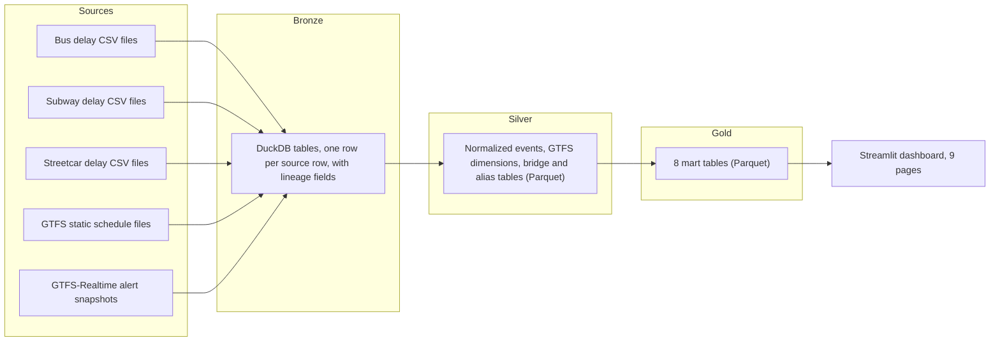

# TTC Pulse

TTC Pulse is a DuckDB, Parquet and Streamlit project that scores how reliable TTC bus, subway and streetcar service has been, by route, station, hour and cause.

## Why it matters

TTC delay logs, route schedules and live service alerts come in different formats. They also use different names for the same routes and stations. Without matching them, it is hard to ask which routes and stations are least reliable, and why. TTC Pulse links the three sources and scores each route and station.

## Results

From the data files committed in this repo:

- 1,111,831 delay events from 1 January 2014 to 31 January 2026. Bus: 723,518. Subway: 235,397. Streetcar: 152,916.
- 97.7% of bus events (706,725 of 723,518) match a route in the GTFS schedule. All subway and streetcar events match.
- Matching is exact for 1,065,527 events (95.8%) and token-based for 46,304 events (4.2%).
- Coverage: 71 subway stations, 4 subway lines, 10 streetcar routes, and 284 bus route keys. Of the bus keys, 204 match a GTFS route.
- The composite reliability score was recomputed from its four inputs for all 893,537 route rows. The stored values match the formula. The largest difference is 2.2e-16.
- The alert validation table holds 37 alerts and 5,984 entity rows. 5,957 rows (99.5%) match a GTFS route. This table comes from one build, so it does not show when each alert was posted (see Status and limits).

## How it works



- `src/ttc_pulse/ingestion/` reads the bus, subway, streetcar and GTFS files. `bronze/build_bronze_tables.py` loads them into DuckDB bronze tables with source file, row ID and row hash fields.
- `src/ttc_pulse/gtfs/build_dimensions.py` and `build_bridge.py` build the GTFS route, stop and service dimensions and the route, direction and stop bridge.
- `src/ttc_pulse/aliasing/` builds the route, station and incident code tables. It also writes review tables for names that do not match cleanly.
- `src/ttc_pulse/normalization/normalize_bus.py`, `normalize_subway.py` and `normalize_streetcar.py` set `match_method` (exact, token or fallback) and `match_confidence` for each event.
- `src/ttc_pulse/facts/build_fact_delay_events_norm.py` builds the event fact table. `build_fact_gtfsrt_alerts_norm.py` builds the alert fact table.
- `src/ttc_pulse/marts/` builds the gold tables. `scoring.py` sets the composite score weights (0.35, 0.30, 0.20 and 0.15). `build_gold_rankings.py` runs all gold builders.
- `src/ttc_pulse/pipeline/load_dataset.py` lists the full run order. `src/ttc_pulse/alerts/` polls the TTC alert feeds. `scripts/alerts/` holds the scheduler installers for macOS and Windows.
- `app/streamlit_app.py` and `app/pages/` show the gold tables. `src/ttc_pulse/dashboard/loaders.py` reads them from DuckDB. When a table is missing from DuckDB, it reads the Parquet file instead.

## Data model

Silver fact, dimension and bridge tables (Parquet):

| Table | Role | Rows |
|---|---|---|
| `fact_delay_events_norm` | Fact: one row per delay event | 1,111,831 |
| `fact_gtfsrt_alerts_norm` | Fact: alert entity rows | 5,984 |
| `dim_route_gtfs` | Dimension: GTFS routes | 229 |
| `dim_stop_gtfs` | Dimension: GTFS stops | 9,417 |
| `dim_service_gtfs` | Dimension: GTFS service calendars | 8 |
| `dim_route_alias` | Alias dimension: route names | 865 |
| `dim_station_alias` | Alias dimension: station names | 13,860 |
| `dim_incident_code` | Alias dimension: incident codes | 267 |
| `bridge_route_direction_stop` | Bridge: route, direction and stop | 17,824 |

Gold mart tables (Parquet, ZSTD compressed):

| Gold table | Rows | Size | What it holds |
|---|---:|---:|---|
| `gold_delay_events_core` | 1,086,378 | 11.3 MB | Events by mode, date, hour, route or station, and incident category |
| `gold_route_time_metrics` | 893,537 | 9.2 MB | Route scores by mode, date and hour |
| `gold_station_time_metrics` | 223,480 | 1.5 MB | Subway station scores by date and hour |
| `gold_time_reliability` | 504 | 12.5 KB | Scores by mode, weekday and hour |
| `gold_top_offender_ranking` | 283 | 8.9 KB | Ranked routes and stations for 31 January 2026 |
| `gold_alert_validation` | 5,984 | 10.9 KB | Alert entity rows checked against GTFS |
| `gold_spatial_hotspot` | 71 | 5.0 KB | Subway station points with scores |
| `gold_linkage_quality` | 752 | 11.6 KB | Match quality by mode and period |

The eight gold tables take 22.0 MB in total. Row counts come from the committed files. The gold tables were built on 16 April 2026.

## Data quality and lineage

- **Source registry.** Four CSV registries list each source file with its size, modified time and SHA-256 checksum. They cover `raw/bus/`, `raw/subway/`, `raw/gtfs/` and `raw/gtfsrt/`. Every row holds a valid SHA-256 value (see Status and limits for a known column-shift bug).
- **Checksum check.** 85 of the 234 committed GTFS-Realtime snapshot files appear in the registry. The SHA-256 value for each of the 85 matches the file contents.
- **Matching tiers.** Normalization labels each event `exact`, `token` or `fallback`, with a confidence score. The committed event fact uses `exact` and `token` only. Events that do not match stay in the data with `link_status = unmatched_review`.
- **QA.** `src/ttc_pulse/qa/build_bus_quality_gate_summary.py` writes 10 QA metrics to `outputs/qa/`. That folder is not committed. The subway station gate needs at least 0.8 station linkage, at most 0.15 ambiguous share and at least 1,000 high-confidence rows (`src/ttc_pulse/marts/build_gold_station_metrics.py`, lines 438 to 445). Each gold builder reports `built` or `built_with_caveats`.
- **Checks you can run.** Summing the committed gold table by mode gives the event totals above:

```sql
SELECT mode, sum(event_count) AS events
FROM read_parquet('gold/gold_delay_events_core.parquet')
GROUP BY mode;
```


## Tech stack

- Python 3.12, DuckDB, pandas and PyArrow.
- Parquet with ZSTD compression for silver and gold tables.
- Streamlit for the dashboard, with Altair charts.
- GTFS-Realtime decoding with `gtfs-realtime-bindings` and `protobuf`.
- APScheduler for a 30-second poll inside the Live Alert page. launchd on macOS and Task Scheduler on Windows run the 30-minute alert poll.
- The OpenAI Python SDK, with the Responses API, for the AI chat page and the AI explain buttons.

## Run it

Tested on macOS with Python 3.12, from a clean clone:

```bash
git clone https://github.com/PATELOM925/TTC-PULSE.git
cd TTC-PULSE
python3.12 -m venv .venv
source .venv/bin/activate
pip install -r requirements.txt
streamlit run app/streamlit_app.py
```

The dashboard reads the committed gold Parquet files. The AI pages need `OPENAI_API_KEY`. Set it in the environment or in a `.env` file at the project root. The other pages do not need it.

Rebuild the gold tables from the committed silver files. This overwrites the tracked files in `gold/`. Commit or copy the folder first:

```bash
PYTHONPATH=src python -m ttc_pulse.marts.build_gold_rankings
```

Run the bus QA summary:

```bash
PYTHONPATH=src python -m ttc_pulse.qa.build_bus_quality_gate_summary
```

The full pipeline does not run from this repository alone. See Status and limits.

## My role

This is a team project for a Data Analytics and Visualization course at York University, Winter 2026. The repository history has three committers: Awais Aziz (40 commits), me (32 commits) and Muhammad Asad (1 commit, the initial commit).

I first added 33 of the 36 pipeline modules:

- Ingestion: 4 of 5 modules (bus, subway, GTFS and the GTFS-Realtime registration).
- Normalization: 4 of 5 modules (bus, subway, GTFS-Realtime entities and the step-2 table registration).
- Aliasing: all 4 modules.
- Bronze: the bronze table builder.
- Facts: both fact builders.
- GTFS dimensions and bridge: both builders.
- Gold marts: all 9 modules, including the shared helper and the scoring module.
- Alerts: 6 of 7 modules, including the alert parser and the sidecar cycle.
- QA: the bus quality-gate summary.

I also created the first version of `README.md`, the scheduler scripts in `scripts/alerts/`, and the three docs in `docs/`.

Awais Aziz built the AI chat page, the AI explain module, the streetcar ingestion and normalization, the pipeline runner `pipeline/load_dataset.py`, the live alert scheduler and the shared dashboard helpers. Awais also changed several modules I created, including the station gold builder and the dashboard loaders.

## Status and limits

- This is a course project. It runs locally.
- The dashboard runs from a clean clone, because the gold tables are committed. The full pipeline does not: the raw source files and the DuckDB database are too large for the repo.
- The route tables include 16,793 bus events (2.3%) that did not match a GTFS route. They are kept under their original route keys and flagged as unmatched.
- The source registry holds a valid SHA-256 checksum for every file, but in most rows the fields are shifted one column to the right. The registry writer needs a fix.
- The alert parser is not idempotent yet: running it again appends rows that are already loaded.
- The alert tables carry one build timestamp per row, so they cannot show when an alert started or changed.
- There are no automated tests and no CI workflow.

## Links

- Live demo: https://iampatelom.com/demos/ttc-pulse (delay explorer built from the gold tables in this repo)
- Team repository (the upstream of this fork): https://github.com/MohammadAsad0/TTC-PULSE
- Docs: [architecture](docs/architecture.md), [technical notes](docs/TECHDOC.md), [project scope](docs/PROJECT_SCOPE.md)
- Live alert feeds used by the poller: `https://gtfsrt.ttc.ca/alerts/{bus,subway,streetcar}?format=text`
- Source data: TTC bus, subway and streetcar delay data from the City of Toronto Open Data portal, and the TTC GTFS schedule and GTFS-Realtime alert feeds.
